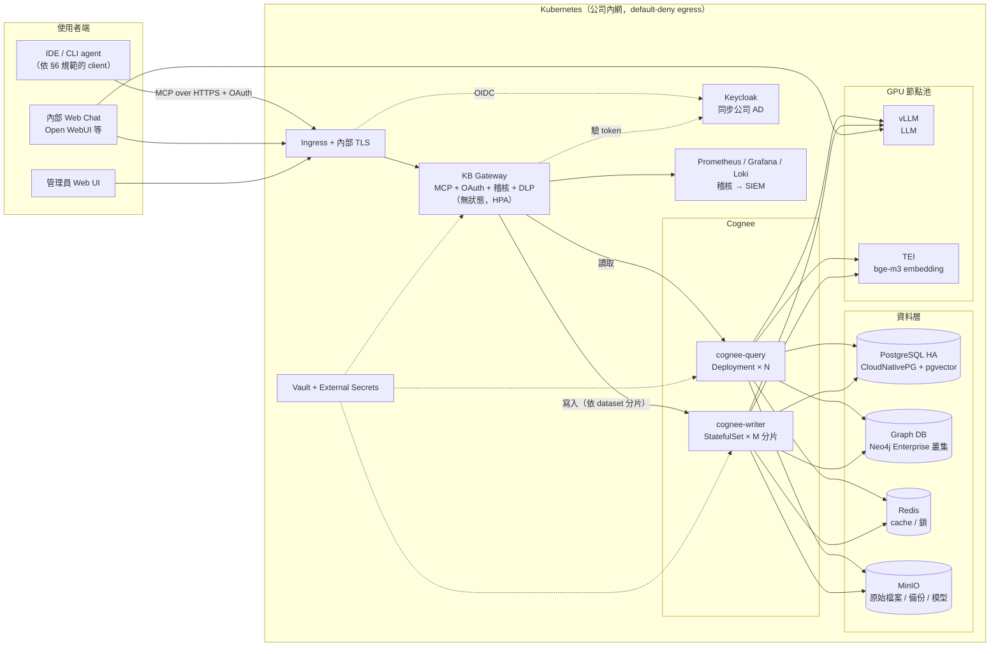
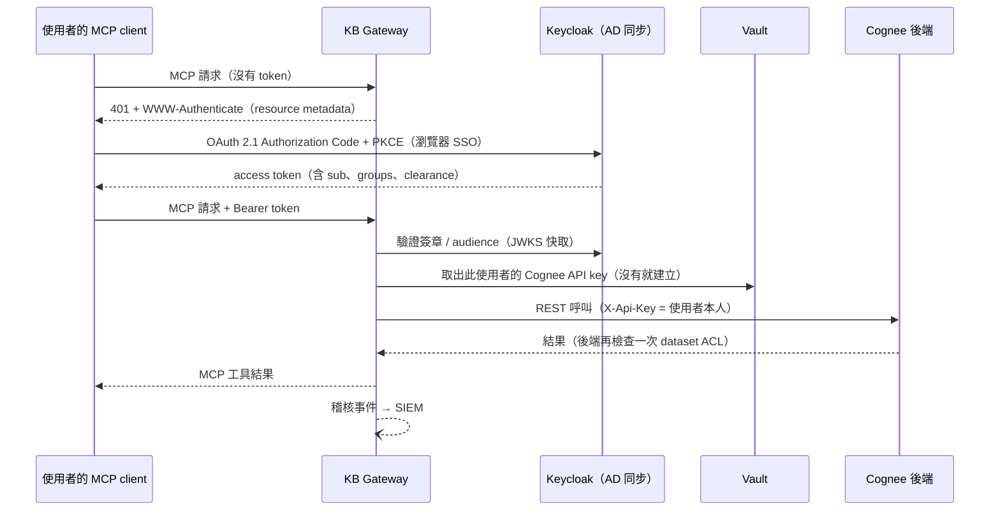
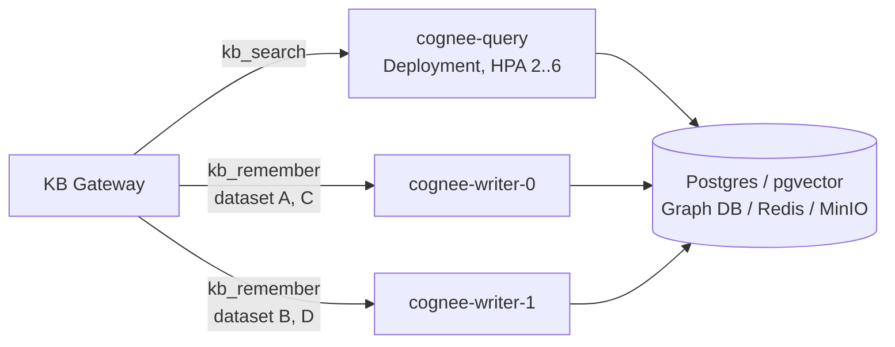
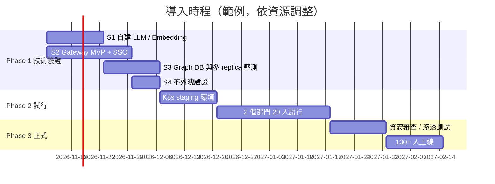

# 企業版知識庫平台設計：100+ 人、Kubernetes、權限控管、資料不外洩

> 狀態：**設計草案 v0.1**（2026-11-01）· 分支：`design/enterprise-k8s`
> 前提：沿用 [POC](GUIDE.md) 的 Cognee 知識圖譜，擴充到 100 人以上、部署在 Kubernetes、依部門 / 專案控管權限，且公司機密資料**不得離開公司網路**（LLM 與 Embedding 全部自建）。
>
> 本文件裡關於 Cognee 行為的描述，都已對照 cognee 1.6.6 原始碼（`main@525b1d1`）確認，並附上檔案位置。標示「**待驗證**」的項目要在 [Phase 1 技術驗證](#12-分階段導入計畫) 中實測。

---

## 目錄

1. [需求與非功能目標](#1-需求與非功能目標)
2. [POC 的哪些設計不能直接放大](#2-poc-的哪些設計不能直接放大)
3. [目標架構總覽](#3-目標架構總覽)
4. [關鍵設計一：KB Gateway（身分、權限、稽核的唯一入口）](#4-關鍵設計一kb-gateway)
5. [關鍵設計二：權限模型](#5-關鍵設計二權限模型)
6. [關鍵設計三：資料不外洩（含 client 端）](#6-關鍵設計三資料不外洩)
7. [關鍵設計四：自建 LLM 與 Embedding](#7-關鍵設計四自建-llm-與-embedding)
8. [關鍵設計五：Cognee 在 K8s 上的擴展方式](#8-關鍵設計五cognee-在-k8s-上的擴展方式)
9. [Kubernetes 部署藍圖](#9-kubernetes-部署藍圖)
10. [容量估算](#10-容量估算)
11. [維運：監控、稽核、備份、災難復原](#11-維運)
12. [分階段導入計畫](#12-分階段導入計畫)
13. [待決策事項](#13-待決策事項)
14. [風險登錄](#14-風險登錄)
15. [附錄：Cognee 原始碼查證摘要](#15-附錄cognee-原始碼查證摘要)

---

## 1. 需求與非功能目標

### 1.1 功能需求

| # | 需求 | 說明 |
|---|---|---|
| F1 | 多人共同維護知識庫 | 透過 MCP 從 AI 工具（IDE / CLI / Web）寫入與查詢 |
| F2 | 依身分控管 | 每個人以自己的公司帳號（SSO）使用，看得到的內容依部門 / 專案 / 機密等級決定 |
| F3 | 可追溯 | 每筆寫入能知道作者；每次查詢能稽核「誰、何時、查了哪個知識庫」 |
| F4 | 批次匯入 | 知識管理員可批次匯入文件（ADR、SOP、規格、事故報告） |
| F5 | 生命週期 | 入職自動開通、調部門自動換權限、離職立即失效 |

### 1.2 非功能目標（建議值，請依公司實際情況調整）

| 項目 | 目標 |
|---|---|
| 使用者規模 | 註冊 150 人、同時在線 30 人、尖峰並行查詢 15 |
| 查詢延遲 | `CHUNKS` P95 < 2 秒；`GRAPH_COMPLETION` P95 < 15 秒 |
| 寫入延遲 | 單筆 `remember` 背景處理 < 3 分鐘；批次匯入於離峰時段執行 |
| 可用性 | 上班時段 99.5%；單一節點故障不中斷查詢 |
| 資料外洩 | **零**對外連線（default-deny egress），所有模型在公司內推論 |
| RPO / RTO | RPO 24 小時（每日備份）+ Postgres WAL 持續歸檔；RTO 4 小時 |

---

## 2. POC 的哪些設計不能直接放大

| POC 做法 | 放大到 100+ 人的問題 | 本設計的對策 |
|---|---|---|
| 所有人共用一個 MCP endpoint、一個服務帳號 | 沒有個人身分，**權限控管無法成立**，也無法稽核 | [KB Gateway](#4-關鍵設計一kb-gateway)：SSO 登入，用每個人自己的 Cognee 身分呼叫後端 |
| cognee-mcp 只認 dataset 名稱 | 名稱只在「自己擁有的」dataset 中解析，分享給別人的 dataset 用不到（[#5619](https://github.com/topoteretes/cognee/issues/5619)） | Gateway 自己實作 MCP 工具，先把名稱換成 UUID，再呼叫 REST API |
| MCP endpoint 沒有驗證 | 連得到 port 的人就能讀、寫、刪 | Gateway 依 MCP Authorization 規格做 OAuth 2.1 |
| 單機 Docker Compose | 單點故障、無法擴充 | Kubernetes + 有狀態元件高可用 |
| Ladybug 檔案型 graph | 單一 process 寫入；大量文件時不穩（[#6170](https://github.com/topoteretes/cognee/issues/6170)） | 改用 Neo4j Enterprise，或在 Ladybug + 共享鎖之間擇一（[§8.3](#83-graph-資料庫選型)） |
| 8B 本機模型 | 中文品質與抽取能力不足 | GPU 節點上用 vLLM 跑 32B 以上的模型 |
| FastEmbed MiniLM（384 維、126 tokens） | 片段太短、中文檢索品質有限 | 自建 `bge-m3`（1024 維、8K tokens），**需重新匯入** |
| Telemetry 預設開啟、`main` 浮動標籤 | 資料外送、版本不可控 | 關閉 telemetry、default-deny egress、內部 registry 釘選 digest |

---

## 3. 目標架構總覽



**設計原則**

1. **Gateway 是唯一入口**：Cognee 後端與 UI 都不直接對使用者開放。後端的註冊 API 無法關閉（`cognee/api/client.py` 一律掛載），因此後端只接受來自 Gateway 的連線（NetworkPolicy）。
2. **權限雙重檢查**：Gateway 先依 SSO 群組檢查一次，Cognee 後端再依 dataset ACL 檢查一次。
3. **讀寫分離**：Cognee 的 dataset 鎖和背景工作都只在單一 process 內有效。查詢可以水平擴展，寫入則依 dataset 固定送到同一個 writer。
4. **公司內推論**：LLM、Embedding、OCR 等所有模型都在叢集內執行。namespace 預設拒絕所有對外連線。

---

## 4. 關鍵設計一：KB Gateway

POC 卡住的根本原因是 cognee-mcp 先天的三個限制：

- **沒有驗證**：`cognee-mcp/src/server.py` 只有 Host/Origin 檢查。
- **只有一個身分**：整個 MCP 實例共用一個 `API_TOKEN`。
- **只認 dataset 名稱**：除了 `forget`，所有工具都只吃名稱。

所以企業版**不直接對使用者開放 cognee-mcp**，改成自建一個薄的 Gateway。

### 4.1 職責

| 職責 | 做法 |
|---|---|
| 身分驗證 | 依 [MCP Authorization 規格](https://modelcontextprotocol.io/specification/2025-06-18/basic/authorization)當 OAuth 2.1 resource server：提供 `/.well-known/oauth-protected-resource`，指向 Keycloak；驗證 access token（JWT、audience = gateway） |
| 身分對應 | SSO 使用者 → Cognee 使用者，第一次登入時自動建立。每人的 Cognee API key 由 Gateway 代為產生，存在 Vault |
| 授權 | 依 token 裡的群組、機密等級和 client 類型（見 [§6.3](#63-client-端是最大的外洩風險)）過濾可用的 dataset |
| 名稱解析 | `GET /api/v1/datasets` 會回傳**分享給呼叫者**的 dataset（`get_all_user_permission_datasets(user, "read")`）。Gateway 先把名稱換成 UUID，再用 `dataset_ids` 呼叫後端，繞過 #5619 |
| 讀寫路由 | 查詢送到 `cognee-query`；寫入依 `hash(dataset_id)` 送到固定的 `cognee-writer-N` |
| DLP | 寫入前掃描，偵測金鑰、密碼、身分證字號、客戶個資等，命中就拒絕寫入並記錄 |
| 作者標記 | 依 token 自動加上 `作者 / 部門 / 時間 / 來源 client`（寫進 `external_metadata` 與 `node_set`），使用者無法偽造 |
| 稽核 | 每次工具呼叫都送出結構化事件到 SIEM（見 [§11.2](#112-稽核)） |
| 限流 | 依使用者與部門設定配額，避免單人用完 GPU |

### 4.2 對外提供的 MCP 工具

| 工具 | 參數 | 對應的 Cognee REST API | 權限 |
|---|---|---|---|
| `kb_list` | — | `GET /api/v1/datasets` | 登入即可 |
| `kb_search` | `query`, `datasets[]`, `mode`(chunks/graph/rag), `top_k` | `POST /api/v1/search`（`dataset_ids`） | read |
| `kb_remember` | `content`, `dataset`, `title` | `POST /api/v1/add`（`datasetId`）→ `POST /api/v1/cognify`（`dataset_ids`, `run_in_background=true`） | write |
| `kb_upload` | `filename`, `content_base64`, `dataset` | 同上 | write |
| `kb_status` | `dataset` | pipeline 狀態 | read |

- **不提供 `forget`**。刪除走管理介面加審核流程。
- 工具描述要寫清楚「`datasets` 必填」，避免 AI 在全部知識庫裡亂查。

### 4.3 登入流程



**待驗證**：

- 各 MCP client（Claude Code、Cursor、VS Code、Open WebUI）對 OAuth 的支援程度不同，例如 Dynamic Client Registration 和 refresh token
- Keycloak 是否需要開啟 DCR，或預先為每種 client 註冊好 client_id

### 4.4 技術選型

- **語言**：Python + 官方 MCP SDK（FastMCP，streamable HTTP），和 Cognee 同一個技術棧
- **狀態**：無狀態。session 用 MCP 的 `mcp-session-id`，需要時存 Redis
- **規模**：預估 1,000–1,500 行，加上單元測試與合約測試（直接對真實 Cognee API 驗證）
- **另一條路**：把 dataset UUID 支援與 per-request 身分轉送貢獻回 cognee-mcp 上游。可以和自建 Gateway 並行，但不建議等上游

---

## 5. 關鍵設計二：權限模型

### 5.1 Cognee 原生能力（已查證）

| 能力 | 支援 | 位置 / 備註 |
|---|---|---|
| Dataset ACL | ✅ `read` / `write` / `delete` / `share` | `PERMISSION_TYPES`；授權對象可以是 user、role、tenant |
| Role | ✅ 建立角色、把使用者加入角色 | `POST /api/v1/permissions/roles`、`POST /users/{id}/roles` |
| Tenant | ✅ 但 `GET /datasets` 只回傳「目前 tenant」的資料 | 跨 tenant 分享不方便 → **建議單一 tenant** |
| SSO / OIDC / LDAP | ❌ 沒有 | 由 Gateway + Keycloak 處理 |
| 關閉註冊 | ❌ 無法關閉 | 後端不對外，只允許 Gateway 連線 |
| 稽核日誌 | ⚠ 只有部分 | `COGNEE_LOG_SEARCH_HISTORY`、`USAGE_LOGGING`（有 TTL）、`PROVENANCE_TRACKING`。正式稽核由 Gateway 負責 |
| 隔離 | ✅ `ENABLE_BACKEND_ACCESS_CONTROL=true` 時每個 dataset 有獨立的向量 schema 和 graph DB | — |

### 5.2 機密等級

| 等級 | 範例 | 可以入庫嗎 | 允許的 client |
|---|---|---|---|
| L1 公開 | 公司公告、公開技術文件 | ✅ | 所有核准的 client |
| L2 內部 | 部門 SOP、內部規範、ADR | ✅ | 所有核准的 client |
| L3 機密 | 專案設計、未公開研究、客戶專案資料 | ✅（專案 dataset） | **只限內部 LLM 的 client**（[§6.3](#63-client-端是最大的外洩風險)） |
| L4 極機密 | 營業秘密、個資原始資料、金鑰 | ❌ 不入庫 | — |

### 5.3 Dataset 命名與授權

```text
<等級>-<範圍>-<主題>
l1-corp-handbook          全公司
l2-dept-ai-sop            AI 部門
l2-dept-ai-adr
l3-proj-alpha-design      Alpha 專案
l3-proj-alpha-incident
u-<員工編號>-notes          個人草稿（只有本人可讀寫）
```

**AD 群組到 Cognee role 的對應**（由 Gateway 的同步工作負責，每 15 分鐘和登入時各同步一次）：

| AD 群組 | Cognee role | 授權 |
|---|---|---|
| `KB-ALL` | `all-staff` | `l1-*`：read |
| `DEPT-AI` | `dept-ai` | `l2-dept-ai-*`：read |
| `DEPT-AI-KB-CURATOR` | `dept-ai-curator` | `l2-dept-ai-*`：read + write |
| `PROJ-ALPHA` | `proj-alpha` | `l3-proj-alpha-*`：read + write |
| `KB-ADMIN` | `kb-admin` | 所有 dataset：delete + share；管理 UI |

**原則**

- 一般成員預設只有 read。寫入權限給知識管理員（curator）或專案成員
- 想貢獻內容的人，先寫進自己的 `u-*-notes`，再由 curator 審核後搬到正式 dataset
- 所有 dataset 由 `kb-admin` 服務帳號建立並擁有，個人不直接擁有團隊 dataset，避免離職時資料一起消失
- `delete` 和 `share` 只給 `kb-admin`

### 5.4 生命週期

| 事件 | 處理 |
|---|---|
| 入職 | AD 加入群組 → 第一次 SSO 登入時 Gateway 建立 Cognee 使用者、API key、role |
| 調部門 | AD 群組變更 → 同步工作調整 role。Token 過期（建議 15 分鐘）後即生效 |
| 離職 | AD 停用 → Keycloak 拒絕 refresh → **最多 15 分鐘**內失效。同步工作再刪除 API key、移出 role |
| 權限稽核 | 每季匯出「誰能讀哪些 dataset」報表，交由部門主管確認 |

---

## 6. 關鍵設計三：資料不外洩

### 6.1 外洩路徑盤點

| # | 路徑 | 風險 | 對策 |
|---|---|---|---|
| E1 | LLM / Embedding 呼叫外部 API | 文件內容整份送出 | 全部自建（[§7](#7-關鍵設計四自建-llm-與-embedding)） |
| E2 | Cognee telemetry | 預設 POST 到 `https://test.prometh.ai`，內容包含 user_id、tenant_id 等（`cognee/shared/utils.py`） | `TELEMETRY_DISABLED=1`（設任何非空值都會關閉） |
| E3 | 執行期間下載 | HuggingFace tokenizer / 模型、tiktoken、LiteLLM 價格表（GitHub）、GLiNER pip install、Ladybug extension | 模型預先打包進映像或 MinIO；`HF_HUB_OFFLINE=1`、`LITELLM_LOCAL_MODEL_COST_MAP=True`、`GLINER_AUTO_INSTALL=false` |
| E4 | **MCP client 端的 LLM** | 使用者用雲端 AI 工具時，`kb_search` 查到的內容會成為 prompt，送到雲端 | [§6.3](#63-client-端是最大的外洩風險) |
| E5 | 查詢問答被寫回知識庫 | `CACHING` 預設開啟，會把問答存進 session，再由 `improve()` 寫進 graph，**其他人可能查到你問過的問題** | `CACHING=false`、`AUTO_FEEDBACK=false`、`IMPROVE_STAGES_DISABLED=persist_session_qa` |
| E6 | Log 外洩 | 忘記密碼的 token 會以 INFO 等級寫進 log；查詢內容也可能進 log | 後端不開放 forgot-password（Gateway 不轉送）；log 只存在內部 Loki，並限制存取 |
| E7 | 容器映像供應鏈 | `main` 浮動標籤（[#6075](https://github.com/topoteretes/cognee/issues/6075)）、第三方映像 | 內部 Harbor 映像、掃描弱點與簽章、釘選 digest |
| E8 | 人為寫入機密 | 有人把金鑰或個資 `remember` 進知識庫 | Gateway DLP 掃描；L4 禁止入庫 |

### 6.2 網路層保證（最重要）

只靠環境變數不夠，**要從網路層讓資料出不去**：

```yaml
# namespace kb-platform：預設拒絕所有 egress，只放行叢集內必要的目的地
apiVersion: networking.k8s.io/v1
kind: NetworkPolicy
metadata: { name: default-deny-egress, namespace: kb-platform }
spec:
  podSelector: {}
  policyTypes: [Egress]
  egress:
    - to: [{ namespaceSelector: { matchLabels: { kubernetes.io/metadata.name: kube-system } } }]
      ports: [{ port: 53, protocol: UDP }, { port: 53, protocol: TCP }]
    - to: [{ podSelector: {} }]          # 同 namespace 內互通（再用更細的 policy 收斂）
    - to: [{ namespaceSelector: { matchLabels: { kubernetes.io/metadata.name: kb-ai } } }]  # vLLM / TEI
```

驗收方式：在每個 pod 內執行 `curl https://huggingface.co`，必須逾時；而且整體功能仍然正常。

### 6.3 Client 端是最大的外洩風險

**就算 LLM 自建，如果同事用的 MCP client 本身接的是雲端 LLM，Gateway 回傳的知識庫內容還是會被送到雲端。** 這是本設計最需要公司政策決定的一點。

| 方案 | 說明 | 適用等級 |
|---|---|---|
| A. 全內部 client | 內部 Web Chat（例如 Open WebUI）、VS Code 擴充套件（例如 Continue、Cline）接到內部 vLLM 的 OpenAI 相容 API，再用 MCP 連 Gateway | L1–L3 |
| B. 雲端 client + 企業合約 | 例如 Claude Code 企業方案、或在公司自己的雲端帳號內使用 Bedrock / Vertex 上的模型，並簽零資料保留、不訓練等條款 | L1–L2（需法務 / 資安核准） |
| C. 雲端 client 接內部 LLM | 用 LiteLLM proxy 讓 CLI agent 改接內部模型 | L1–L3，但 agent 能力受內部模型限制（**待驗證**） |

**Gateway 依 client 強制執行**：Keycloak 為不同 client 發不同的 `client_id` 和 scope。Gateway 依 `client_id` 判斷 client 類型：雲端類 client 的 token **只能看到 L1 / L2 dataset**，查詢 L3 一律拒絕。這條規則寫在 Gateway 的政策設定檔裡，並納入稽核。

> 具體可以採用哪些 client，請在 [§13 待決策事項](#13-待決策事項) 由資安與法務決定。

---

## 7. 關鍵設計四：自建 LLM 與 Embedding

### 7.1 推論服務

| 元件 | 建議 | 理由 |
|---|---|---|
| LLM 服務 | **vLLM**（OpenAI 相容 API） | 高吞吐（continuous batching）、支援 structured output、K8s 生態成熟 |
| Embedding 服務 | **HuggingFace TEI**（或 vLLM embedding 模式） | 專門做 embedding，延遲低 |
| 模型來源 | 公司內 MinIO 模型庫，由 init container 下載 | 執行期不連 HuggingFace |

### 7.2 模型選擇（需實測；授權條款請法務確認）

**LLM**：Cognee 需要穩定的 JSON / structured output 來抽取實體與關係。官方文件把 7B 以下模型列為不穩定，POC 實測 8B 模型也會出現中英文混雜。

| 候選 | 大小 | 優點 | 注意 |
|---|---|---|---|
| Qwen3-32B / Qwen2.5-32B-Instruct | 32B | 中文強、structured output 穩、授權寬鬆 | 主要建議 |
| Llama-3.3-70B-Instruct | 70B | 英文與推理強 | 需要更多 GPU；Llama 社群授權 |
| TAIDE（Llama-3.1-TAIDE 系列） | 8B | 台灣在地用語、繁體中文 | 太小，不適合做抽取；可評估用在查詢回答 |
| Breeze 2 系列 | 8B 等 | 繁體中文 | 同上 |

**Embedding**：

| 候選 | 維度 | 最大長度 | 說明 |
|---|---|---|---|
| **BAAI/bge-m3** | 1024 | 8192 tokens | 多語言、中文檢索佳、MIT 授權 → **建議** |
| multilingual-e5-large | 1024 | 512 | 備選 |

> ⚠ 從 POC 的 MiniLM（384 維）換成 bge-m3（1024 維）時，**必須重建所有 dataset**，因為 Cognee 會因維度不符拒絕寫入。正式上線前就要定案，之後不要再換。

### 7.3 Cognee 設定（已對照原始碼，未實測）

```dotenv
# LLM：vLLM 必須用 custom provider，模型名稱要帶 LiteLLM 前綴
LLM_PROVIDER=custom
LLM_MODEL=hosted_vllm/Qwen/Qwen3-32B
LLM_ENDPOINT=http://vllm.kb-ai.svc:8000/v1
LLM_API_KEY=internal-dummy-key        # 不可留空，否則會靜默改用 demo extractor
STRUCTURED_OUTPUT_FRAMEWORK=litellm_native

# Embedding：openai_compatible 會自動補 /v1
EMBEDDING_PROVIDER=openai_compatible
EMBEDDING_MODEL=BAAI/bge-m3
EMBEDDING_ENDPOINT=http://tei.kb-ai.svc:80
EMBEDDING_API_KEY=internal-dummy-key
EMBEDDING_DIMENSIONS=1024             # 一定要設，未知模型預設會變成 3072
HUGGINGFACE_TOKENIZER=BAAI/bge-m3     # tokenizer 要預先放進映像或快取

# 不外洩
TELEMETRY_DISABLED=1
HF_HUB_OFFLINE=1
LITELLM_LOCAL_MODEL_COST_MAP=True
GLINER_AUTO_INSTALL=false
CACHING=false
AUTO_FEEDBACK=false
IMPROVE_STAGES_DISABLED=persist_session_qa
```

### 7.4 GPU 規劃（估算）

| 方案 | 硬體 | 可跑 | 備註 |
|---|---|---|---|
| 最小 | 1 × 48 GB GPU（L40S / A6000 等級） | 32B FP8 或 AWQ + bge-m3 | 單點，適合試行階段 |
| 建議 | 2 × 80 GB GPU（H100 / A100 等級），分在兩個節點 | 每卡一份 32B（2 replicas）+ TEI | 單卡故障仍可服務 |
| 進階 | 4 × 80 GB GPU | 70B（TP=2）× 2 replicas | 需要更強推理時 |

---

## 8. 關鍵設計五：Cognee 在 K8s 上的擴展方式

### 8.1 原始碼查證到的限制

| 限制 | 位置 | 影響 |
|---|---|---|
| 背景 cognify 是 API process 內的 `asyncio.create_task` | `modules/pipelines/layers/pipeline_execution_mode.py` | 沒有分散式 worker；pod 重啟時正在跑的工作會中斷 |
| dataset 鎖只在 process 內有效 | `infrastructure/locks/dataset_lock.py`（原始碼註解明寫） | 兩個 pod 同時寫同一個 dataset 不受保護 |
| 進度 websocket 只看得到同一個 pod 的工作 | `modules/pipelines/queues/pipeline_run_info_queues.py` | 需要 sticky routing，或改用輪詢狀態 |
| gunicorn 固定 `-w 1` | 後端 `entrypoint.sh` | 只能用 pod 數量擴展 |
| 官方 Helm chart 只有單一 replica、預設關閉 access control | `deployment/helm/` | 只能當參考，要自建 chart |
| 中斷工作的回收用 FileLock | `modules/pipelines/run_ownership.py` | `SYSTEM_ROOT_DIRECTORY` 需要共享，或各 writer 各自擁有 |

### 8.2 讀寫分離 + 寫入分片



- **cognee-query**：只處理查詢（search、datasets、status），可以水平擴展。所有 pod 使用相同的 `FASTAPI_USERS_*` secret 和 `CACHE_BACKEND=redis`。
- **cognee-writer**：StatefulSet。Gateway 用 `hash(dataset_id) mod M` 決定送到哪個 writer，同一個 dataset 永遠由同一個 pod 處理，process 內的鎖因此仍然有效。writer 數量固定，調整 M 時要先排空工作。
- **工作可靠性**：Gateway 記錄每個寫入請求，pod 重啟後依 pipeline 狀態補送。cognify 的中斷回收由 `COGNEE_STALE_RUN_RECOVERY_MIN_AGE_SECONDS` 控制。
- **待驗證**：多個 query pod 同時讀同一個 dataset 是否安全，需在 Phase 1 用壓力測試確認。

### 8.3 Graph 資料庫選型

| 選項 | access control 下的行為 | K8s 友善 | 正式可用 | 結論 |
|---|---|---|---|---|
| **Neo4j Enterprise**（handler `neo4j`） | 每個 dataset `CREATE DATABASE` | ✅（官方 Helm、叢集） | ✅ | **建議**，需要授權費 |
| Neo4j Community（`neo4j_community`） | 為每個 dataset 用 docker CLI 啟動一個容器 | ❌ pod 裡沒有 docker | — | 不適用 |
| Postgres graph（`postgres_graph_shared`） | 每個 dataset 一個 schema | ✅ | ❌ 原始碼標示「demo，not production-ready」 | 只能當後備 |
| Ladybug（`ladybug`） | 每個 dataset 一個 `.lbug` 檔 | ⚠ 需要 RWX 儲存 + `SHARED_LADYBUG_LOCK`（Redis） | ⚠ 大量文件時不穩（#6170） | 預算不足時的過渡方案 |
| Neptune 等雲端服務 | 沒有 access control handler | — | — | 不適用（也違反不外洩） |

**建議**：Phase 1 同時壓測 Neo4j Enterprise 與 Ladybug + RWX，再依授權預算定案。

### 8.4 其他資料層

| 元件 | 建議 | 備註 |
|---|---|---|
| 關聯 DB + 向量 | CloudNativePG（3 instances、同步複寫）+ pgvector | `VECTOR_DATASET_DATABASE_HANDLER=pgvector_shared`。pgvector 目前沒有 ANN 索引（[#4362](https://github.com/topoteretes/cognee/issues/4362)），資料量大時需要評估 |
| Cache / 鎖 | Redis（Sentinel 或 Operator） | `CACHE_BACKEND=redis` |
| 原始檔案 | MinIO（`STORAGE_BACKEND=s3`、`AWS_ENDPOINT_URL`） | **待驗證** MinIO 相容性 |

---

## 9. Kubernetes 部署藍圖

### 9.1 Namespace 與元件

| Namespace | 元件 | 類型 | 副本 |
|---|---|---|---|
| `kb-gateway` | kb-gateway | Deployment + HPA | 2–6 |
| `kb-platform` | cognee-query | Deployment + HPA | 2–6 |
| | cognee-writer | StatefulSet | 2（固定分片） |
| | postgres（CNPG） | Cluster | 3 |
| | redis | StatefulSet / Operator | 3 |
| | neo4j | StatefulSet（官方 chart） | 3（叢集） |
| | minio | StatefulSet / Operator | 4（erasure coding） |
| | cognee-ui | Deployment（只給管理員，外層加 oauth2-proxy） | 1 |
| `kb-ai`（GPU 節點） | vllm | Deployment | 2 |
| | tei | Deployment | 2 |
| `kb-auth` | keycloak | StatefulSet / Operator | 2 |
| 共用 | ingress-nginx、cert-manager（內部 CA）、external-secrets + Vault、prometheus-stack、loki、velero | — | — |

### 9.2 Repo 預計結構（本分支後續實作）

```text
├── docs/
│   ├── GUIDE.md                    POC 指南（現有）
│   └── ENTERPRISE_DESIGN.md        本文件
├── gateway/                        KB Gateway（Python, FastMCP）
│   ├── src/                        auth / policy / dlp / routing / tools
│   ├── policy.yaml                 機密等級 × client 類型 × 群組 規則
│   └── tests/
├── deploy/
│   ├── helm/kb-platform/           umbrella chart（gateway, cognee-query/writer, ui）
│   ├── values/                     dev / staging / prod
│   └── policies/                   NetworkPolicy、PodSecurity、ResourceQuota
├── images/
│   └── cognee-offline/Dockerfile   預先放入 tokenizer、tiktoken、Ladybug extension
└── docker-compose.yml              POC（保留，給本機開發用）
```

### 9.3 安全基線

- 所有 pod：`runAsNonRoot`、唯讀根檔案系統（可寫目錄另外掛 volume）、移除所有 capabilities、Pod Security Admission 設 `restricted`
- 映像：內部 Harbor + 弱點掃描 + cosign 簽章 + admission 只允許已簽章的映像
- Secret：Vault → External Secrets，不放在 Git 或 values 裡；`FASTAPI_USERS_*` 所有 pod 共用同一組並定期輪替
- 傳輸：Ingress 用內部 CA 的 TLS；叢集內是否加 mTLS（service mesh）見 [§13](#13-待決策事項)
- 靜態加密：PV 用支援加密的 StorageClass；MinIO 啟用 SSE

---

## 10. 容量估算

> 以下是**起始估算**，Phase 1 要用壓力測試修正。

**假設**：註冊 150 人、每日活躍 60%、每人每天查詢 20 次、寫入 3 次；尖峰小時佔全日 20%。

| 指標 | 計算 | 結果 |
|---|---|---|
| 每日查詢 | 150 × 0.6 × 20 | 1,800 次 |
| 尖峰每分鐘查詢 | 1,800 × 0.2 ÷ 60 | 約 6 次 / 分 |
| 每日寫入 | 150 × 0.6 × 3 | 270 筆 |
| 首次批次匯入 | 假設 5,000 份文件 | 離峰分批進行，需多個夜間時段 |

**資源起始配置**

| 元件 | requests | limits | 備註 |
|---|---|---|---|
| kb-gateway | 0.5 CPU / 512Mi | 1 CPU / 1Gi | — |
| cognee-query | 1 CPU / 2Gi | 2 CPU / 4Gi | — |
| cognee-writer | 2 CPU / 4Gi | 4 CPU / 8Gi | POC 實測單一後端約 1.7 GB |
| postgres | 2 CPU / 8Gi | 4 CPU / 16Gi | 每個 instance |
| neo4j | 2 CPU / 8Gi | 4 CPU / 16Gi | 每個 instance |
| vLLM | 1 GPU / 8 CPU / 32Gi | — | 每個 replica |

**瓶頸在 GPU 的 cognify**：抽取實體和關係每份文件要呼叫 LLM 很多次。批次匯入要排離峰時段，Gateway 也要對寫入設配額。

---

## 11. 維運

### 11.1 監控

| 面向 | 指標 |
|---|---|
| Gateway | 每個工具的 QPS、延遲、錯誤率；被拒絕的授權次數；DLP 攔截次數 |
| Cognee | `/health`、pipeline 成功 / 失敗數、cognify 佇列長度、各 writer 負載 |
| LLM | vLLM 的 token/s、佇列長度、TTFT、GPU 使用率與記憶體 |
| 資料層 | Postgres 複寫延遲、連線數；Neo4j heap；MinIO 容量 |

### 11.2 稽核

Gateway 每次工具呼叫都送出一筆 JSON 到 SIEM，保存期限依公司規定：

```json
{
  "ts": "2026-11-01T09:12:33Z", "user": "a12345", "groups": ["DEPT-AI", "PROJ-ALPHA"],
  "client_id": "open-webui", "client_class": "internal",
  "tool": "kb_search", "datasets": ["l3-proj-alpha-design"], "decision": "allow",
  "query_sha256": "…", "result_doc_ids": ["…"], "latency_ms": 1840
}
```

- 查詢原文是否保存，由資安決定。預設只存 hash，需要時再開啟全文
- 拒絕事件（越權、DLP 命中、client 等級不符）要即時告警

### 11.3 備份與災難復原

| 對象 | 方式 | 頻率 |
|---|---|---|
| Postgres | CNPG barman → MinIO（另一機房） | WAL 持續 + 每日 base backup |
| Neo4j | `neo4j-admin database backup` | 每日 |
| MinIO 原始檔案 | 複寫到另一個 MinIO | 持續 |
| K8s 資源 / PV | Velero | 每日 |
| 演練 | 在 staging 完整還原 | 每季 |

> Postgres 與 graph DB 要在**同一個時間點**備份，否則圖譜和向量會對不起來。在維護時段暫停 writer（scale 到 0）再備份，或接受最多一次 cognify 的差異，之後重跑。

### 11.4 版本升級

- 釘選 Cognee 映像 digest；每月評估上游版本
- 升級流程：staging 還原 production 備份 → 升級 → 自動化回歸測試（查詢品質樣本集）→ production

---

## 12. 分階段導入計畫



### Phase 1：技術驗證（每項都要有明確的通過條件）

| # | 驗證項目 | 通過條件 |
|---|---|---|
| S1 | vLLM + Qwen 32B、TEI + bge-m3 接 Cognee | 用 POC 的 sample-data 加 50 份真實文件，cognify 成功率 ≥ 98%；中文問答由 3 人盲評，可接受率 ≥ 80% |
| S2 | Gateway MVP：OAuth（Keycloak）、`kb_search` / `kb_remember`、名稱轉 UUID | Claude Code / VS Code / Open WebUI 至少兩種 client 完成 SSO 登入；Bob 查得到 Alice 分享的 dataset；未授權的查詢被拒絕 |
| S3 | Graph DB 選型與多 replica | 3 個 query pod、2 個 writer，模擬 30 人並行 30 分鐘，沒有資料錯亂或鎖錯誤，P95 達到 §1.2 目標 |
| S4 | 不外洩 | default-deny egress 下所有功能正常；從 pod 內連外全部失敗；封包側錄中沒有對外連線 |

### Phase 2：試行

- 選 1 個部門（L2）加 1 個專案（L3），共 20 人
- 每週收集回饋：查詢品質、延遲、權限是否合理
- 驗證入職、調部門、離職的自動化流程

### Phase 3：正式上線

- 資安審查、滲透測試（重點是 Gateway 授權繞過、prompt injection 造成越權查詢）
- 上線教育訓練：機密等級、可用的 client、禁止寫入的內容
- 維運交接：SOP、值班、告警

---

## 13. 待決策事項

| # | 決策 | 選項 | 建議 | 決策者 |
|---|---|---|---|---|
| D1 | 允許的 MCP client | A 全內部 / B 雲端加企業合約 / C 混合 | C：L3 只限內部 client | 資安、法務 |
| D2 | 身分來源 | 公司 AD 直接用 / Keycloak 同步 AD / 既有 SSO 平台 | Keycloak 同步 AD（支援 MCP 需要的 OAuth 2.1 / PKCE） | IT |
| D3 | K8s 平台 | 既有叢集 / 新建（RKE2、OpenShift） | 依 IT 現況 | IT |
| D4 | Graph DB | Neo4j Enterprise（授權費）/ Ladybug + RWX | 先壓測（S3）再決定 | 架構 + 預算 |
| D5 | GPU 預算 | 最小 / 建議 / 進階（§7.4） | 建議方案 | 主管 |
| D6 | LLM 模型 | Qwen3-32B / Llama 3.3 70B / 其他 | Qwen3-32B（待 S1 實測） | 架構 |
| D7 | 查詢原文是否保存 | 只存 hash / 全文 | 只存 hash，事件調查時再開啟 | 資安 |
| D8 | 叢集內 mTLS | 不用 / Istio / Linkerd | Phase 3 再評估 | 架構 |
| D9 | 是否回饋上游 | 自建 Gateway / 同時貢獻 cognee-mcp | 兩者並行 | 團隊 |

---

## 14. 風險登錄

| 風險 | 可能性 | 影響 | 緩解 |
|---|---|---|---|
| 雲端 client 把 L3 內容送出 | 中 | 高 | Gateway 依 client 強制；教育訓練；稽核告警 |
| Prompt injection（文件裡藏指令，誘使 AI 越權） | 中 | 中 | 權限在 Gateway / 後端強制，不依賴 AI 判斷；`datasets` 必填 |
| Cognee 上游行為變更 | 高 | 中 | 釘選 digest；合約測試；每月升級評估 |
| 多 replica 下資料錯亂 | 中 | 高 | 寫入分片；S3 壓測；writer 數量固定 |
| 自建 LLM 抽取品質不足 | 中 | 中 | S1 盲評；保留可換模型的設計（embedding 除外） |
| GPU 成為瓶頸 | 高 | 中 | 離峰批次匯入；配額；必要時加卡 |
| Embedding 模型更換 | 低 | 高 | 上線前定案；預留重建流程與時間 |
| 後端註冊 API 被濫用 | 低 | 高 | 後端不對外，NetworkPolicy 只允許 Gateway |

---

## 15. 附錄：Cognee 原始碼查證摘要

查證版本：cognee 1.6.6 / cognee-mcp 0.5.7（`main@525b1d1`，2026-10-29）。

| 主題 | 結論 | 來源 |
|---|---|---|
| 背景工作 | process 內 `asyncio.create_task`，沒有分散式佇列 | `cognee/modules/pipelines/layers/pipeline_execution_mode.py` |
| 鎖 | dataset / session 鎖只在 process 內有效 | `cognee/infrastructure/locks/dataset_lock.py`, `session_lock.py` |
| Cache | `CACHE_BACKEND` = redis / postgres / sqlite（預設）等；`CACHING` 預設 true | `cognee/infrastructure/databases/cache/config.py` |
| Ladybug 共享鎖 | `SHARED_LADYBUG_LOCK` 需要 Redis 或 Postgres cache | `graph/ladybug/adapter.py` |
| Helm | 單一 replica、預設 `enableBackendAccessControl: false` | `deployment/helm/` |
| Neo4j handler | `neo4j` 需要 Enterprise（CREATE DATABASE）；`neo4j_community` 用 docker CLI | `neo4j_driver/*DatasetDatabaseHandler.py` |
| Postgres graph | 標示為 demo，not production-ready | `graph/postgres_demo/adapter.py` |
| 權限 API | `/api/v1/permissions/*`（datasets、roles、tenants、capabilities） | `api/v1/permissions/routers/get_permissions_router.py` |
| 分享的 dataset | `GET /api/v1/datasets` 會回傳分享給呼叫者的 dataset | `get_all_user_permission_datasets(user, "read")` |
| SSO | 沒有（OAuth 只用在資料來源整合） | — |
| 註冊 | 一律掛載，無法關閉 | `cognee/api/client.py` |
| 自建 LLM | `LLM_PROVIDER=custom` + `hosted_vllm/<model>`；`LLM_API_KEY` 不可空 | `modules/preflight/config_preflight.py` |
| 自建 Embedding | `EMBEDDING_PROVIDER=openai_compatible`（自動補 `/v1`） | `OpenAICompatibleEmbeddingEngine.py` |
| Telemetry | POST 到 `https://test.prometh.ai`；`TELEMETRY_DISABLED` 設任何非空值即關閉 | `cognee/shared/utils.py` |
| MCP 驗證 | 沒有；只有 Host/Origin 檢查；單一 `API_TOKEN` | `cognee-mcp/src/server.py` |
| MCP 工具參數 | 只有 `forget` 接受 UUID | `cognee-mcp/src/server.py` |
| Workers | gunicorn 固定 `-w 1` | 後端 `entrypoint.sh` |
